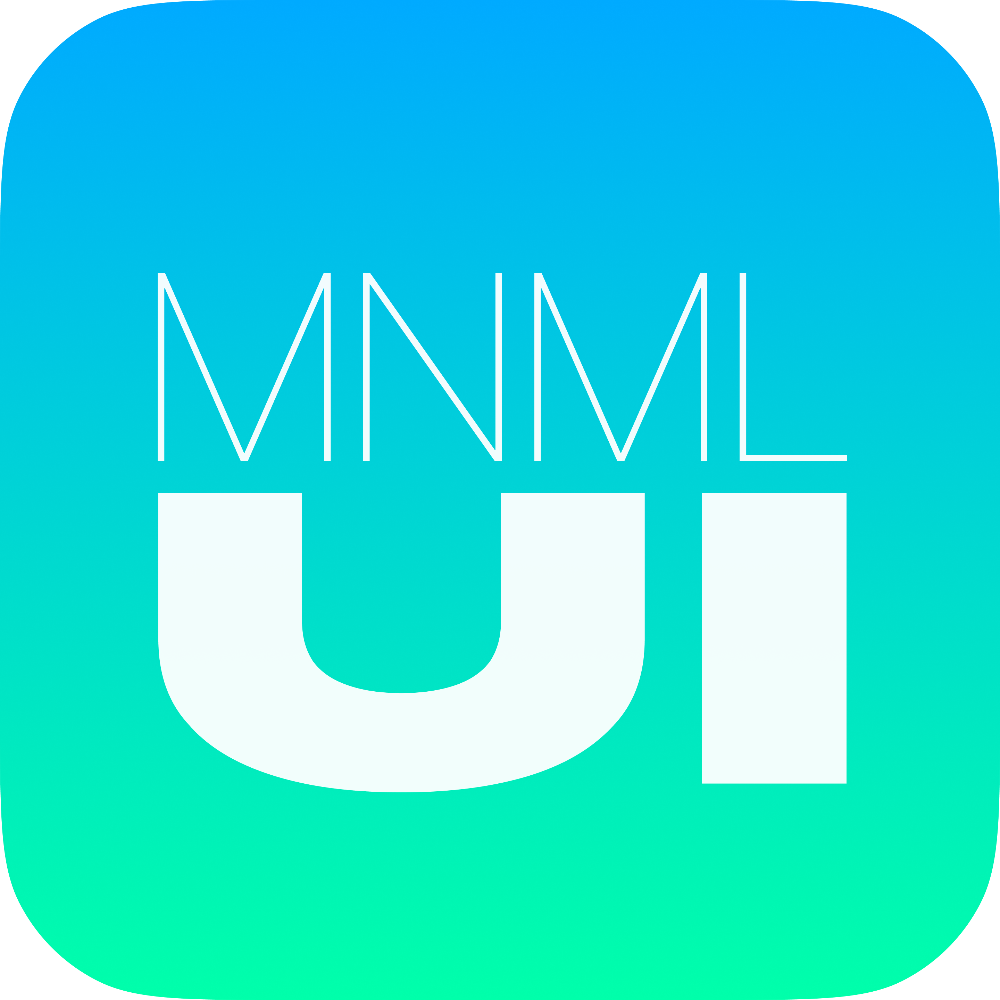

# [Documentation](https://hishamc24.gitbook.io/mnmlui/)



## MNMLUI

A CDN That allows any website to use the Minimal UI software ecosystem.

Import via this one line:

```html
<script src="https://hishamc24.github.io/MNMLUI/MNMLUI.js"></script>
```

If you want just the styling, import that one stylesheet. No longer recommended since it does NOT have the dynamically adjusting drop shadow:

```html
<link rel="stylesheet" href="https://hishamc24.github.io/MNMLUI/CSS/Styles.css" />
```

also, to have an accent color, in your `:root` set `--MNMLUI-ACCENT` to a hex value, like so:

```css
:root {
  --MNMLUI-ACCENT: #ff0080;
}
```

Example Components and their usage can be found inside `/HTML/`

## How did we get here?

MNMLUI is a unified design language that is meant to bring together the best parts of both iOS(26+) and OneUI(8+).

Apple introduced Liquid Glass in iOS26, and subtly also changed the design of all buttons and interactable items, having them separated from the edges of the screen, floating above the main content below the page. All buttons now have their own dedicated spot.


Samsung later on introduced floating components and tab bar as well, close in design to iOS26.

OneUI8:


iOS26:


And then a thought appeared: "What if I make my own rendition of this floating tab bar design for my own work?" This started the foundation of MNMLUI.

[NewGenUI](https://lightslicergp.github.io/NewGenUI/) is my first test of this, finding the right spacing and designing the tab bar to adapt to multiple items. While it is okay, there is much room to be desired. [The playground within the site](https://lightslicergp.github.io/NewGenUI/TestPlayground/) came later, where the idea of having a simple importable CDN started coming to mind.

After some time, I created MNMLUI, bringing in the code from the NewGenUI Playground to start off, having a usable floating tab bar, and a single importable .js line. Later, I extracted the glassy material styles into its own file if a user only wanted to have just the styles, so they can import a single .css file.